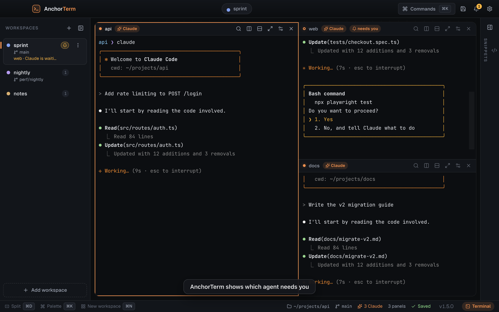
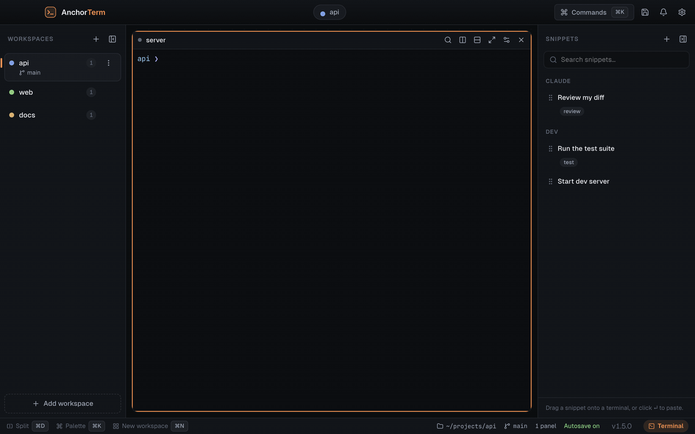
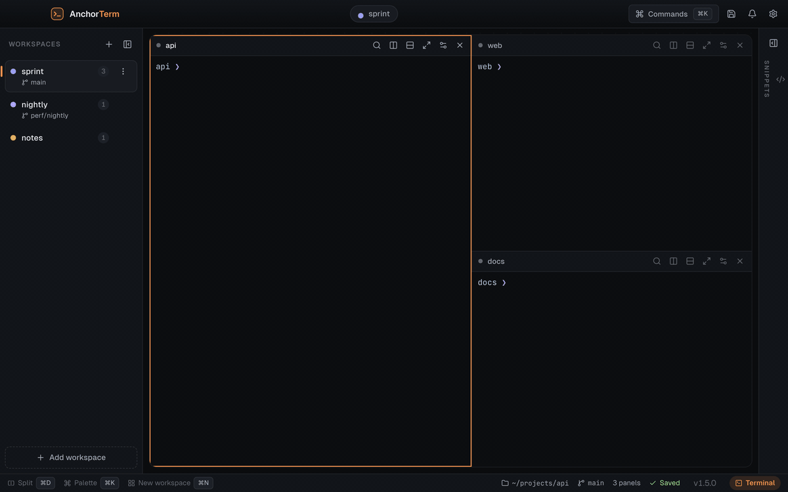
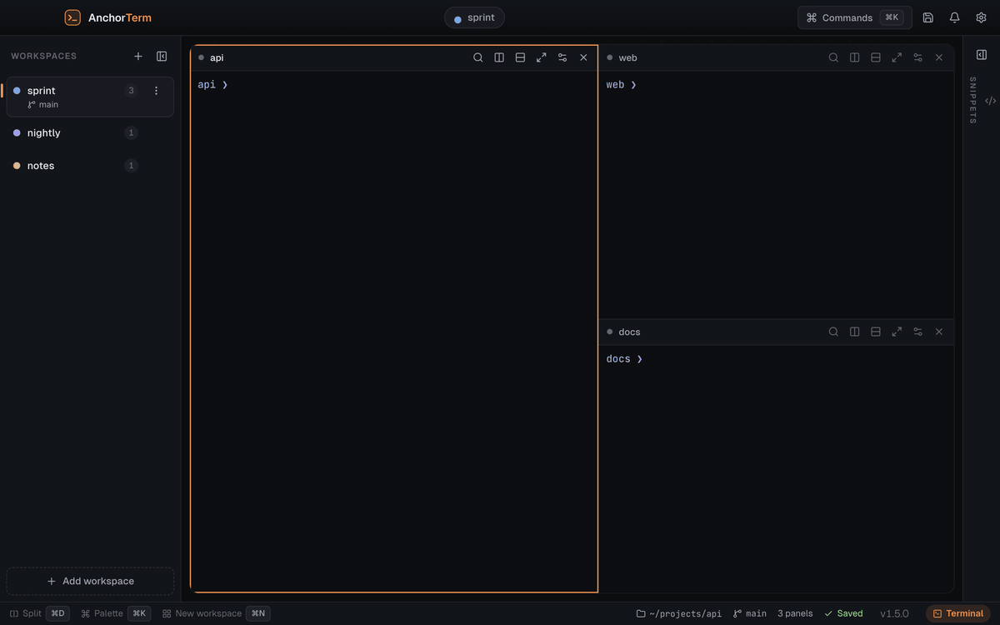

<div align="center">

# AnchorTerm: the terminal for AI coding agents

**A free multi-panel terminal for Claude Code and Codex CLI. Run many agents side by side, see which one needs you, and get every session back after a restart. macOS, Linux and Windows (some features are macOS and Linux only, see [platform notes](#platform-notes)).**



[](https://github.com/alanperius/anchorterm-releases/releases/latest)

[Download](#download-anchorterm-for-macos-linux-and-windows) · [Why use it](#why-use-it-if-you-work-with-ai) · [Features](#features-of-the-ai-coding-terminal) · [Shortcuts](#keyboard-shortcuts) · [FAQ](#faq-claude-code-terminal-codex-cli-and-privacy)

</div>

AnchorTerm is a desktop **terminal for AI coding agents**. It is a **Claude Code terminal** and a **Codex CLI** terminal in one: real shells in resizable **multi-panel** layouts, grouped into workspaces, with a sidebar that tells you which agent is waiting for you. It is a **terminal with session restore**: close the app or reboot, and your panes, their folders and your Claude Code and Codex sessions come back where you left them. If you run agents in tmux splits today, it is a local desktop **alternative to tmux splits** for AI agents (it does not keep remote sessions alive the way tmux does). It is free and runs on macOS, Linux and Windows.

> This repository hosts the **downloadable installers**. The source code is private.
>
> AnchorTerm itself sends no code, terminal output or telemetry anywhere. Its only network traffic is the update check against GitHub (see the [FAQ](#faq-claude-code-terminal-codex-cli-and-privacy)).

## Why use it if you work with AI

If you run Claude Code or Codex all day, a plain terminal gets in the way. These are the problems AnchorTerm is built around.

| The pain | What AnchorTerm does |
| --- | --- |
| You reboot or update and lose your Claude conversations. You dig through `claude --resume` ids to find them. | On quit it saves each pane's layout, real folder and Claude session id. On next launch it types `claude --resume <id>` in every pane whose Claude was running. Codex panes resume with `codex resume <id>`. |
| You run six agents and do not know which one is blocked on a permission prompt. | Panes running Claude Code or Codex get a badge. A pane that needs you gets a pulsing dot and a "needs you" tag (Codex alerts work in zsh and bash panes). The sidebar shows a count per workspace and a line like `api · Claude is asking you a question`. |
| You are in your browser while an agent waits. | A desktop notification fires when an agent finishes or needs input and the window is not focused. Clicking it opens the exact pane, even in another workspace. Optional chime for Claude panes, and a macOS Dock count of workspaces with a Claude pane waiting (shown while the window is in the background). |
| You juggle tabs, windows or tmux splits, and re-`cd` into the project in every pane. | Split right or down (up to 16 panes per workspace). A new pane opens in the same folder as the focused one. One workspace per project or client, switch with `Cmd/Ctrl+1..9`. |
| You cannot tell which branch each project is on. | The sidebar and status bar show the git branch of the pane you are in (macOS and Linux, not in ssh panes, can be switched off in Settings). |
| You want to send the same prompt to several agents. | Broadcast input types once into all panes, or all Claude panes, of a workspace. |
| You paste a screenshot for Claude and have to save it, find it and type the path. | Paste the image. AnchorTerm saves it to a private temp file and types the path for you. |
| A resume should never hand an agent more power. | AnchorTerm never re-adds `--dangerously-skip-permissions` or a looser permission mode when it resumes Claude. It re-applies only `--add-dir` folders and the default, plan or dontAsk modes. If two panes held the same conversation, only one of them resumes it. |

### Run many Claude Code and Codex agents side by side

Split a window into panels, give each workspace a colour, and see the git branch of the pane you are in, in the sidebar.



### See which AI agent needs you

Claude Code and Codex panes are detected automatically, even when you type `claude` by hand. When one finishes, asks a question, wants a plan approved or hits an error, you see it in the pane, in the sidebar and in a desktop notification (Claude Code everywhere; Codex alerts work in zsh and bash panes). Click the notification to land in that pane.



### Restore Claude Code sessions after a reboot

Autosave runs after every change and on quit, sleep and screen lock. Reopen and each pane returns in its folder, with its Claude session resumed.



## AnchorTerm vs a regular terminal

What changes when your terminal knows about AI coding agents:

| | Regular terminal (iTerm2, Terminal, Windows Terminal, GNOME Terminal…) | + tmux | AnchorTerm |
| --- | --- | --- | --- |
| Split panels and tabs | Yes | Yes | Yes, plus colour-coded workspaces |
| Knows a pane is running Claude Code or Codex | No | No | Yes, automatically |
| Tells you which agent finished or needs you | Only with a bell or your own setup | Only with your own setup | Yes: pane mark, sidebar line, desktop notification |
| Brings back Claude Code / Codex conversations after a reboot | No | No (tmux-resurrect restores panes, not conversations) | Yes, one `--resume` per pane |
| Restores panes and their folders after a reboot | Varies by app | With plugins | Yes |
| Keeps a session alive on a remote server after you disconnect | No | Yes, its main strength | No (you can still run `ssh` or `tmux` inside a pane) |

AnchorTerm does not replace tmux on a server. It is for the local desktop workflow: many agents, many projects, one window.

## Features of the AI coding terminal

- **Real terminals.** Every pane is an xterm.js terminal on a real PTY, so vim, htop, ssh and agent TUIs work. Unicode widths, `Option` as Meta on Mac, 5000 lines of live scrollback per pane.
- **Split panels.** Split right or down, up to 16 per workspace, drag dividers, maximize one pane and restore, rename panes by double-click.
- **Workspaces.** Colour-coded, reorderable, renameable. Per-workspace mute for noisy projects. A per-workspace Claude command lets you run a second account (for example an alias `claudep`) in one project.
- **Claude Code support.** Auto-detection, session resume, a session browser (`Browse Claude sessions` in the palette), profile-aware resume with `CLAUDE_CONFIG_DIR`, and restored `--add-dir` folders and the safe permission modes (default, plan, dontAsk). Bypass is never re-applied.
- **Codex CLI support.** Detection, a Codex badge, `codex resume <id>`, and "needs input" versus "finished" alerts (alerts work in zsh and bash panes; in fish, Windows or when launched by full path, Codex is still detected and resumed but sends no alerts). Written against Codex CLI 0.159.3 to 0.162.1. Codex support is new and was checked with the CLI's help output and source, not long real-world use.
- **Notifications.** Pane marks, a sidebar line, desktop notifications, an optional chime for Claude panes, a macOS Dock count, and a notification log (`Cmd+Shift+I`) with jump to the latest unread.
- **Scripts can ping you too.** OSC 9/777/99 notifications and the `anchorterm-notify` command mark a pane with a neutral hollow diamond, separate from an agent waiting for you. The `anchorterm-notify` command works in zsh and bash on macOS and Linux.
- **Clickable errors.** URLs open in your browser. `src/app.ts:42:7` style paths open in your editor at that line (VS Code, Cursor, JetBrains IDEs, Zed, Sublime Text or a custom command).
- **Paste and drop.** Safe bracketed paste, `Shift+Enter` for multi-line Claude prompts, image paste, and file drag and drop that quotes unsafe names. Optional confirmation for risky pastes such as `rm -rf` or `sudo`.
- **Search.** In one pane or across all open panes at once, with match case.
- **Broadcast input.** One keystroke stream into several panes.
- **Per-pane zoom.** 8 to 32 px, saved with the pane.
- **Snippets.** Searchable prompts and commands, seeded with 17 (one of them launches Claude with permissions skipped, so read before you paste). Drag one onto a terminal to paste it.
- **Command palette.** `Cmd+K` or `Ctrl+Shift+P` reaches every action.
- **Command history.** Opt-in, searchable, off by default.
- **Seven dark themes.** Midnight Amber, Mono Cyan, Evergreen, Royal Indigo, Crimson, Sky and Graphite, plus window opacity.
- **Quake-style hotkey.** Optional global shortcut to show or hide the window from any app.
- **Export and import.** Move a layout between machines. Exports hold workspace names, colours, layout, pane titles, folders and zoom, plus snippets if you tick them. They hold no settings, sessions, scrollback or history. Imports are previewed, never run anything, and can be undone.
- **Built to survive.** Atomic saves, a last good copy, session history you can restore from, crash and hang dialogs that never kill your shells on their own, and flood protection so one runaway pane cannot freeze the window.
- **Diagnostics.** One-click redacted report, plus `AnchorTerm --doctor <out.json>` when the app will not start.

## Quick start

1. Open AnchorTerm. You get one workspace with one terminal.
2. Split it with `Cmd+D` / `Ctrl+Shift+D` (right) or `Cmd+Shift+D` / `Ctrl+Shift+E` (down).
3. `cd` into a project and run `claude` (or `codex`) in a pane. A **Claude** or **Codex** badge appears.
4. Add a second workspace with `Cmd+N` / `Ctrl+Shift+N` for another project.
5. Quit, or reboot. Reopen and every pane returns in its folder, with Claude and Codex conversations resumed.
6. Press `Cmd+K` / `Ctrl+Shift+P` any time to find an action.

## Keyboard shortcuts

macOS uses `Cmd`. Linux and Windows use `Ctrl+Shift` so shortcuts do not collide with terminal control keys.

| Action | macOS | Linux / Windows |
| --- | --- | --- |
| Command palette | `Cmd+K` | `Ctrl+Shift+P` |
| Save workspace | `Cmd+S` | `Ctrl+Shift+S` |
| Settings | `Cmd+,` | `Ctrl+,` |
| Command history | `Cmd+Shift+H` | `Ctrl+Shift+H` |
| Notifications | `Cmd+Shift+I` | `Ctrl+Shift+I` |
| Jump to latest unread notification | `Cmd+Shift+U` | `Ctrl+Shift+Y` |
| New workspace | `Cmd+N` | `Ctrl+Shift+N` |
| Next / previous workspace | `Cmd+Shift+]` / `Cmd+Shift+[` | `Ctrl+Shift+]` / `Ctrl+Shift+[` |
| Go to workspace 1 to 9 | `Cmd+1` to `Cmd+9` | `Ctrl+1` to `Ctrl+9` |
| Split right / down | `Cmd+D` / `Cmd+Shift+D` | `Ctrl+Shift+D` / `Ctrl+Shift+E` |
| Close panel (immediate, no confirmation) | `Cmd+W` | `Ctrl+Shift+W` |
| Maximize / restore panel | `Cmd+Enter` | `Ctrl+Shift+Enter` |
| Search in terminal | `Cmd+F` | `Ctrl+Shift+F` |
| Copy / paste | `Cmd+C` / `Cmd+V` | `Ctrl+Shift+C` / `Ctrl+Shift+V` (also `Ctrl+Insert` / `Shift+Insert`) |
| Newline without sending (made for Claude Code; sends ESC+Enter in every pane) | `Shift+Enter` | `Shift+Enter` |
| Toggle sidebar / snippets | `Cmd+B` / `Cmd+J` | `Ctrl+Shift+B` / `Ctrl+Shift+J` |
| Zoom this pane in / out / reset | `Cmd+Plus` / `Cmd+-` / `Cmd+0` | `Ctrl+Plus` / `Ctrl+-` / `Ctrl+0` |
| Focus panel up / down / left / right (only when focus is outside a terminal: sidebar or header) | `Alt+Arrow` | `Alt+Arrow` |

Plain `Ctrl+C` always sends SIGINT. `Alt+Arrow` pane focus works when the keyboard is outside a terminal (sidebar, header). Inside a terminal, `Alt+Arrow` stays word motion for your shell. Double-click a workspace or panel name to rename it.

## Download AnchorTerm for macOS, Linux and Windows

Get the latest installer from the **[Releases page](https://github.com/alanperius/anchorterm-releases/releases/latest)**:

| OS | File | Notes |
| --- | --- | --- |
| **Linux**: Debian/Ubuntu/Pop!_OS | `anchorterm_amd64.deb` | installs to your launcher |
| **Linux**: any distro | `AnchorTerm.AppImage` | portable, no install |
| **macOS**: Apple Silicon | `AnchorTerm-arm64.dmg` | M1/M2/M3/M4 |
| **macOS**: Intel | `AnchorTerm-x64.dmg` | |
| **Windows** | `AnchorTerm-Setup.exe` | installer, also a portable `.exe` |

### ⬇️ Direct downloads (latest)

- 🐧 **Linux · Debian/Ubuntu/Pop!_OS**: [`anchorterm_amd64.deb`](https://github.com/alanperius/anchorterm-releases/releases/latest/download/anchorterm_amd64.deb)
- 🐧 **Linux · portable (any distro)**: [`AnchorTerm.AppImage`](https://github.com/alanperius/anchorterm-releases/releases/latest/download/AnchorTerm.AppImage)
- 🍎 **macOS · Apple Silicon**: [`AnchorTerm-arm64.dmg`](https://github.com/alanperius/anchorterm-releases/releases/latest/download/AnchorTerm-arm64.dmg)
- 🍎 **macOS · Intel**: [`AnchorTerm-x64.dmg`](https://github.com/alanperius/anchorterm-releases/releases/latest/download/AnchorTerm-x64.dmg)
- 🪟 **Windows · installer (recommended)**: [`AnchorTerm-Setup.exe`](https://github.com/alanperius/anchorterm-releases/releases/latest/download/AnchorTerm-Setup.exe)
- 🪟 **Windows · portable (no install)**: [`AnchorTerm-Portable.exe`](https://github.com/alanperius/anchorterm-releases/releases/latest/download/AnchorTerm-Portable.exe)

## Install

### 🐧 Linux: Debian / Ubuntu / Pop!_OS (`.deb`)

The reliable one-liner (downloads and installs; avoids broken browser downloads):

```bash
curl -fL -o anchorterm.deb \
  https://github.com/alanperius/anchorterm-releases/releases/latest/download/anchorterm_amd64.deb
sudo apt install ./anchorterm.deb
```

Prefer the browser? Download the `.deb` from the Releases page, then either
**double-click it** (installs via your software centre) or
`sudo apt install ~/Downloads/anchorterm_amd64.deb`.

> **`E: Unsupported file … given on commandline`** means the file you downloaded
> is incomplete or corrupted (not a real `.deb`). Use the `curl` command above. A
> good file is ~99 MB; check with `file anchorterm.deb`, which should say *"Debian binary package"*.

Then launch from your apps menu (**AnchorTerm**) or run `anchorterm`.

### 🐧 Linux: any distro (AppImage, no install)

```bash
curl -fL -o AnchorTerm.AppImage \
  https://github.com/alanperius/anchorterm-releases/releases/latest/download/AnchorTerm.AppImage
chmod +x AnchorTerm.AppImage
./AnchorTerm.AppImage
```

### 🍎 macOS (`.dmg`)

1. Download the build for your chip (Apple menu → **About This Mac**: "Apple M…" =
   Apple Silicon, otherwise Intel):

   ```bash
   # Apple Silicon (M1/M2/M3/M4)
   curl -fL -o AnchorTerm.dmg \
     https://github.com/alanperius/anchorterm-releases/releases/latest/download/AnchorTerm-arm64.dmg

   # Intel
   curl -fL -o AnchorTerm.dmg \
     https://github.com/alanperius/anchorterm-releases/releases/latest/download/AnchorTerm-x64.dmg
   ```

2. Open `AnchorTerm.dmg` and drag **AnchorTerm** onto the **Applications** folder.
3. First launch (the app is ad-hoc signed, not from a paid developer account):
   in Applications, **right-click AnchorTerm → Open → Open**.

   If macOS says **"AnchorTerm.app is damaged and can't be opened"** (Gatekeeper
   on an internet-downloaded app), clear the quarantine flag once in Terminal:

   ```bash
   xattr -dr com.apple.quarantine /Applications/AnchorTerm.app
   # if it still won't open, re-apply an ad-hoc signature locally:
   codesign --force --deep --sign - /Applications/AnchorTerm.app
   open /Applications/AnchorTerm.app
   ```

### 🪟 Windows (`.exe`)

Download the **installer**,
[`AnchorTerm-Setup.exe`](https://github.com/alanperius/anchorterm-releases/releases/latest/download/AnchorTerm-Setup.exe),
and run it. On the blue SmartScreen prompt (unsigned app) click
**More info → Run anyway**, then follow the wizard. There is also a **portable**
[`AnchorTerm-Portable.exe`](https://github.com/alanperius/anchorterm-releases/releases/latest/download/AnchorTerm-Portable.exe)
that runs without installing.

## Updates

AnchorTerm checks for new versions at startup and every 6 hours:

- **Windows installer (NSIS) and Linux AppImage**: updates download in the background. You see
  **"Update ready: Restart & update"** and it installs on restart.
- **Linux `.deb` and macOS**: you are told a new version exists, with a quiet
  **New** badge next to the version in the status bar. Auto-install is not available there (`.deb` is managed by
  `apt`, and macOS in-place updates need a paid Apple Developer signature while the app is only ad-hoc signed). The Windows portable `.exe` is not verified to update in place either, so download the new file from Releases.

## How session resume works

AnchorTerm saves each pane's layout, real working directory and, for Claude Code, the session id and profile. The id is learned from Claude's hooks, its own session registry, and the `claude --resume <id>` line Claude prints on exit. On the next launch it types `claude --resume <id>` in each pane whose Claude was still running when you quit. Panes where you had already left Claude get a plain shell with a **Resume session** button.

A live process cannot survive a reboot. What comes back is the saved conversation, through Claude's own resume. If no trusted session id was captured, the pane starts a fresh `claude`. Codex works the same way with `codex resume <id>`.

Autosave runs about a second after a change, every 20 seconds, on quit, and on sleep or screen lock. Saved scrollback (off, short, medium or long) is shown dimmed above the new shell. Quitting is designed to finish within about 5 seconds, writing the state first.

## Platform notes

| Feature | macOS | Linux | Windows |
| --- | --- | --- | --- |
| Terminal, panels, workspaces, session restore | Yes | Yes | Yes |
| Claude Code detection and resume | Yes | Yes | Yes |
| Codex alerts and `anchorterm-notify` | zsh and bash | zsh and bash | Not available |
| Git branch in the sidebar | Yes (not in ssh panes) | Yes (not in ssh panes) | No |
| Dock count | Yes | No | No |

## FAQ: Claude Code terminal, Codex CLI and privacy

**Is AnchorTerm a good terminal for Claude Code?**
It is built for it: panes running `claude` are detected, resumed after a reboot, and marked when they need you. It also works with Codex CLI and as a normal terminal.

**Is it free?**
Yes. Download it from the Releases page and use it. The source code is private.

**Does it send my code anywhere?**
AnchorTerm itself sends no code, terminal output or telemetry anywhere. Its only network traffic is the update check against GitHub (`api.github.com`, for the `alanperius/anchorterm-releases` repo) at startup and every 6 hours, plus the installer download. Claude Code and Codex send data to their own providers as they always do. A short tail of each pane's scrollback (off, or short, medium or long, via the Scrollback setting) and, if you turn it on, command history are saved in the local data folder only. Pasted images are written to a private temp folder and the path is typed into the pane. The notification log is kept in memory only and starts empty after a restart. The text of notifications that scripts or programs send (OSC 9/777/99) is never saved, logged or put in diagnostics.

**Does AnchorTerm collect telemetry?**
No. There is no analytics or crash reporting. The only network call is the update check to GitHub.

**Does it need Claude Code installed?**
No. It is a normal terminal first. Claude Code features such as resume and alerts appear when you run `claude` in a pane.

**Does it work with Codex?**
Yes. Panes running `codex` are recognised (on by default), tagged, resumed with `codex resume <id>`, and alert you when Codex needs input or finishes. Alerts work in zsh and bash panes. In fish, Windows or when launched by full path, Codex is still detected and resumed but sends no alerts. It was written against Codex CLI 0.159.3 to 0.162.1 and checked with the CLI's help output and source, not long real-world use. AnchorTerm does not read your Codex config.

**What about the privacy of export files and diagnostics?**
An export file holds only workspace names, colours, layout, pane titles, folders (home written as `~/…`) and, if you tick it, snippets. It never holds settings, Claude or Codex sessions or commands, scrollback or history. Importing never runs or resumes anything. Anyone you send the file to sees your folder and pane names.
The diagnostics report (`Copy diagnostics` in the palette) holds versions, platform, a fixed list of boolean and number settings, counts, saved-pane states, the data folder path and the last 200 log lines. Terminal output, scrollback, commands, environment values and folder or pane names are not inputs. Token-like text becomes `<secret>` and user and host names are replaced. Redaction is best effort, so read it before posting publicly.

**Which platforms are supported?**
macOS 11+ (Apple Silicon and Intel), Windows 10/11 (x64) and Linux x64 with glibc. There is no ARM Linux or Windows ARM build. The sidebar git branch is not available on Windows yet.

**Can I move my layout to another computer?**
Yes. Use **Export workspaces…** and **Import workspaces…** in the palette or in Settings > Backup.

---

<div align="center">
Made for developers who live in the terminal and work with AI agents.
</div>
